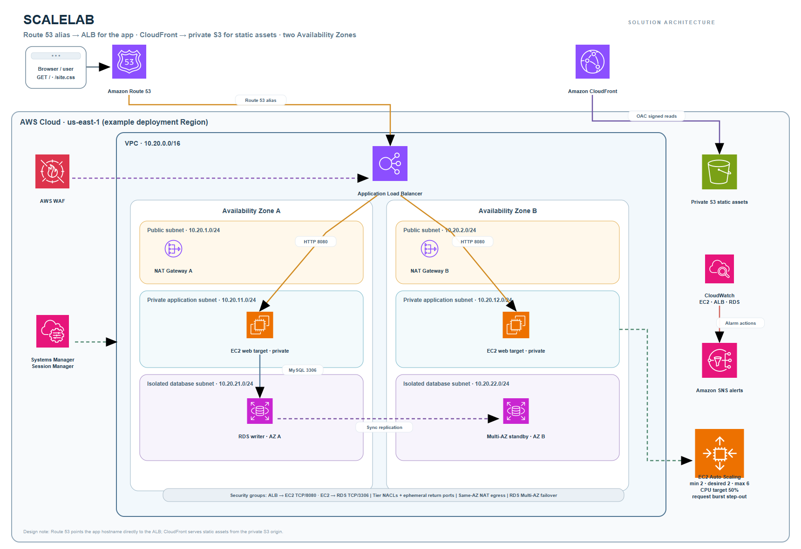

# ScaleLab — Scalable Web Application with ALB and Auto Scaling

**AWS Solutions Architect – Associate graduation project · Project 1**

ScaleLab is a small web application used to demonstrate a production-style, multi-tier AWS design. The application runs on Amazon EC2 instances in private subnets, scales behind an Application Load Balancer, and stores its shared state in a private Multi-AZ Amazon RDS for MySQL database. CloudFront serves versioned static assets from a private S3 bucket. AWS WAF, Systems Manager Session Manager, CloudWatch, SNS, and optional Route 53 DNS complete the design.



The editable source is [docs/architecture.drawio](docs/architecture.drawio); [docs/architecture.svg](docs/architecture.svg) is the vector preview. The diagram uses the official AWS architecture icon package and is laid out for two Availability Zones.

## Project goals

- Design a VPC with public, private application, and isolated database subnets across two Availability Zones.
- Keep application and database compute private; expose only the ALB and NAT gateways to the internet.
- Distribute requests with an ALB and scale EC2 capacity using an Auto Scaling target-tracking policy.
- Cache static assets through CloudFront while keeping the S3 origin private with Origin Access Control.
- Protect the ALB with AWS WAF managed common rules and a rate limit.
- Use RDS Multi-AZ, managed database credentials, least-privilege security groups, and encrypted storage.
- Operate private EC2 instances through Systems Manager Session Manager without inbound SSH or a bastion host.
- Observe application health and infrastructure metrics with CloudWatch alarms, a dashboard, and an SNS topic.

## Architecture

```text
Browser ── app hostname / HTTP(S) ──> Route 53 alias ──> AWS WAF ──> ALB
   │                                                              │
   └── /site.css ──> CloudFront ── OAC ──> private S3 bucket      └──> EC2 Auto Scaling
                                                                      private app subnets
                                                                      ├── AZ A / NAT A
                                                                      └── AZ B / NAT B
                                                                             │
                                                                         RDS MySQL
                                                                         Multi-AZ
```

Route 53 is optional and points the application hostname directly to the ALB, as requested by the project brief. CloudFront is a separate static-asset origin; the application HTML references the CloudFront URL for `site.css`. The stack creates a Route 53 health check when a domain is configured. Without a domain, the ALB DNS name is the application URL.

The two NAT gateways keep outbound access for the private app tier available within each AZ. RDS subnets have no default route to the internet or NAT. An S3 gateway VPC endpoint keeps S3 traffic from the app subnets on the AWS network. The default deployment uses two EC2 instances, one per AZ, and scales between 2 and 6 instances with both a 50% average CPU target-tracking policy and a request-burst step-scaling policy.

### Subnet and route plan

| Tier | AZ A | AZ B | Route | Main resources |
|---|---|---|---|---|
| Public | `10.20.1.0/24` | `10.20.2.0/24` | Internet Gateway | ALB, NAT Gateway |
| Application private | `10.20.11.0/24` | `10.20.12.0/24` | NAT Gateway in same AZ; S3 gateway endpoint | EC2 Auto Scaling instances |
| Database isolated | `10.20.21.0/24` | `10.20.22.0/24` | Local VPC route only | RDS Multi-AZ subnet group |

The template uses security groups as the main stateful control. Tier-specific network ACLs add stateless rules for web ingress, ALB-to-app traffic, app-to-database traffic, and the required ephemeral return traffic. Review the ACL rule entries in `infra/template.yaml` if you change subnet CIDRs or ports.

### Request and operations flows

1. A browser requests the application hostname. If configured, Route 53 returns the ALB alias. AWS WAF evaluates managed common protections and a per-IP rate rule before the ALB forwards traffic.
2. The ALB checks `/healthz` and sends healthy requests to port `8080` on EC2 targets in private application subnets.
3. The stateless Flask application reads the managed database secret using its instance role and updates a shared page-view counter in RDS. The database security group accepts MySQL only from the application security group.
4. The HTML loads `site.css` from the CloudFront distribution. CloudFront reads from the private S3 origin using OAC; the bucket blocks all public access.
5. CloudWatch evaluates Auto Scaling group CPU, ALB target request volume and 5xx responses, and RDS CPU. A sustained request burst triggers step scaling; other alarms publish to an SNS topic. The stack creates the topic but does not subscribe an email address.
6. An operator starts an SSM Session Manager session through the AWS console or CLI. No inbound SSH rule, key pair, or bastion host is created.

## Repository contents

```text
.
├── README.md
├── README.ar.md
├── app/
│   ├── app.py
│   ├── requirements.txt
│   └── static/site.css
├── docs/
│   ├── architecture.drawio
│   ├── architecture.svg
│   ├── architecture.png
│   └── aws-icon-attribution.md
├── infra/template.yaml
└── scripts/
    ├── deploy.ps1
    ├── destroy.ps1
    └── verify.ps1
```

## Deploy to your AWS account

This project creates billable resources. The template has not been deployed as part of this deliverable. Review the AWS estimate and account limits before launching, use a training account, and delete the stack when finished.

### Prerequisites

- AWS CLI v2 configured with credentials for the target training account and region.
- PowerShell 7 or Windows PowerShell 5.1.
- Permissions for CloudFormation, VPC, EC2, Auto Scaling, Elastic Load Balancing, RDS, S3, CloudFront, WAF, IAM, CloudWatch, SNS, and Route 53 if using a custom domain.
- Two available Availability Zones in the selected Region.
- Optional: a Route 53 hosted zone and an ACM certificate in the same Region as the ALB. Set `CertificateArn` to enable HTTPS and HTTP-to-HTTPS redirection. The CloudFront static distribution uses its default `cloudfront.net` certificate.

### Launch

From the repository root:

```powershell
./scripts/deploy.ps1 -Region us-east-1
```

For a custom application hostname and TLS certificate:

```powershell
./scripts/deploy.ps1 `
  -Region us-east-1 `
  -DomainName app.example.com `
  -HostedZoneId Z0123456789EXAMPLE `
  -CertificateArn arn:aws:acm:us-east-1:123456789012:certificate/00000000-0000-0000-0000-000000000000
```

The script creates the CloudFormation stack, uploads `app/static/` to the private S3 bucket, and requests a CloudFront invalidation. It prints the application URL and static asset URL when complete. The first instance launch may take several minutes while it installs the application dependencies and waits for the RDS endpoint.

### Subscribe to alerts

After deployment, confirm an email subscription to the `AlarmTopicArn` stack output. Until a subscription is confirmed, alarms are visible in CloudWatch but no email is delivered.

### Verify

```powershell
./scripts/verify.ps1 -Region us-east-1
```

The script checks `/healthz`, the homepage, and the CloudFront-served stylesheet. For additional validation, use the checklist below.

## Validation checklist

- **Availability Zones:** confirm the ALB has subnets in two AZs and the Auto Scaling group launches targets into both private application subnets.
- **Target health:** open EC2 → Target Groups and verify both targets report `healthy`.
- **Private access:** confirm app EC2 instances have no public IPv4 address and their security group has no inbound SSH rule.
- **Session Manager:** start a session to an instance using Systems Manager; verify no bastion is needed.
- **Database isolation:** confirm RDS is Multi-AZ, encrypted, not publicly accessible, and accepts port 3306 only from the app security group.
- **Static delivery:** request the `StaticAssetsURL` plus `/site.css`; confirm the response comes through CloudFront. An anonymous direct S3 object request should be denied.
- **WAF:** inspect sampled requests and WAF metrics; in a controlled test, submit repeated requests to observe the rate rule.
- **Scaling:** generate a controlled CPU load on test instances and observe the target-tracking policy add capacity; stop the test and observe scale-in.
- **Failover learning exercise:** in a non-production account, use the RDS console's reboot-with-failover option and verify the app reconnects to the stable RDS endpoint.
- **Monitoring:** open the `DashboardName` output and inspect alarms for EC2 CPU, ALB target 5xx responses, and RDS CPU.

Do not run load or failover exercises against production or an account with important data.

## Security decisions

- ALB ingress is public on HTTP; an optional ACM certificate enables HTTPS and redirects HTTP to HTTPS.
- EC2 targets are in private subnets, have IMDSv2 required, encrypted gp3 root volumes, and no SSH ingress.
- The EC2 role uses `AmazonSSMManagedInstanceCore` plus read access to only the RDS-managed secret ARN.
- The RDS master password is generated and stored by RDS in Secrets Manager. Credentials are never put in this repository or user data.
- App, ALB, and database security groups restrict each layer to the required source and port.
- RDS has encrypted storage, seven-day automated backups, and no public route or public address.
- The S3 bucket blocks public access and only grants `GetObject` to the CloudFront distribution via OAC.
- AWS WAF attaches AWS Managed Rules Common Rule Set and a 2,000-request-per-five-minute per-IP rate limit.
- The stack uses AWS-managed service encryption for the RDS storage and S3 assets. A customer-managed KMS key, secret rotation, CloudTrail log archive, AWS Config, and centralized audit account are possible extensions.

## Cost and cleanup

This is an educational architecture, not a low-cost sandbox. Two NAT gateways, an ALB, WAF, CloudFront requests, Route 53 health checks (when configured), a Multi-AZ RDS instance, EC2 instances, and data transfer can incur charges. Actual pricing depends on region, traffic, and storage; use the AWS Pricing Calculator for an estimate before deployment.

Delete the stack after the exercise:

```powershell
./scripts/destroy.ps1 -Region us-east-1
```

The cleanup script empties only the asset bucket created by the named stack, then deletes that stack and waits for completion. The stack's RDS instance is configured for deletion without a final snapshot; take a manual snapshot first if you need to retain the data. Review CloudFormation events and billing after cleanup.

## Learning outcomes mapped to the brief

| Brief outcome | Where to explore |
|---|---|
| VPC, subnet, route table, NAT design | `infra/template.yaml`, `docs/architecture.drawio` |
| High availability across AZs | ALB subnets, two ASG subnets, two NAT gateways, RDS Multi-AZ |
| ALB listener and target health checks | `ApplicationLoadBalancer`, listeners, `ApplicationTargetGroup` |
| Target-tracking and step scaling | `CpuTargetTrackingPolicy`, `RequestBurstStepScalingPolicy`, `RequestBurstAlarm` |
| WAF, security groups, private subnets | `ApplicationWebACL`, tier security groups and NACLs |
| Session Manager instead of a bastion | EC2 role and private app subnets |
| CloudFront caching for static assets | S3 origin, OAC, managed caching policy, deployment script |
| Operational metrics and notifications | CloudWatch dashboard and alarms, SNS topic |

## Known limits and extensions

- This reference stack creates a single-region application; it does not implement cross-region disaster recovery.
- The optional DNS record targets the ALB directly to follow the project brief. CloudFront only fronts static assets in this design.
- HTTPS for the application hostname requires a certificate in the ALB's Region. Without it, the app URL uses HTTP.
- The bootstrap installs Python packages from public package indexes through NAT. For controlled production rollouts, bake dependencies into a reviewed AMI or deploy immutable artifacts through a CI/CD pipeline.
- The sample page counter is intentionally small and is not a workload benchmark. Production applications should use connection pooling, migration management, and an appropriate database capacity plan.
- The SNS topic requires a confirmed subscription. No email recipient is hard-coded.
- Network ACLs must be reviewed when port, subnet, or egress requirements change; they are stateless and need explicit return-path rules.

## Sources

- [AWS Architecture Icons](https://aws.amazon.com/architecture/icons/) — official icons and diagramming resources; AWS lists draw.io as a supported tool.
- [EC2 Auto Scaling networking with Amazon VPC](https://docs.aws.amazon.com/autoscaling/ec2/userguide/asg-in-vpc.html) — public and private subnet considerations, multi-AZ placement, NAT, and Session Manager access.
- [Application Load Balancers](https://docs.aws.amazon.com/elasticloadbalancing/latest/application/introduction.html) — ALB behavior and target routing.
- [Amazon RDS Multi-AZ deployments](https://docs.aws.amazon.com/AmazonRDS/latest/UserGuide/Concepts.MultiAZ.html) — high availability and failover behavior.
- [Systems Manager Session Manager](https://docs.aws.amazon.com/systems-manager/latest/userguide/session-manager.html) — managed instance access without inbound ports.
- [AWS WAF managed rule groups](https://docs.aws.amazon.com/waf/latest/developerguide/aws-managed-rule-groups.html) — AWS-managed rule groups.
- [CloudFront Origin Access Control](https://docs.aws.amazon.com/AmazonCloudFront/latest/DeveloperGuide/private-content-restricting-access-to-s3.html) — private S3 origins.

## Credits

Project idea and required outcomes are based on **AWS Solutions Architect - Associate Graduation Project Ideas**, by Ayman Aly Mahmoud. AWS service icons are from the current official AWS architecture icon package; see [docs/aws-icon-attribution.md](docs/aws-icon-attribution.md).
